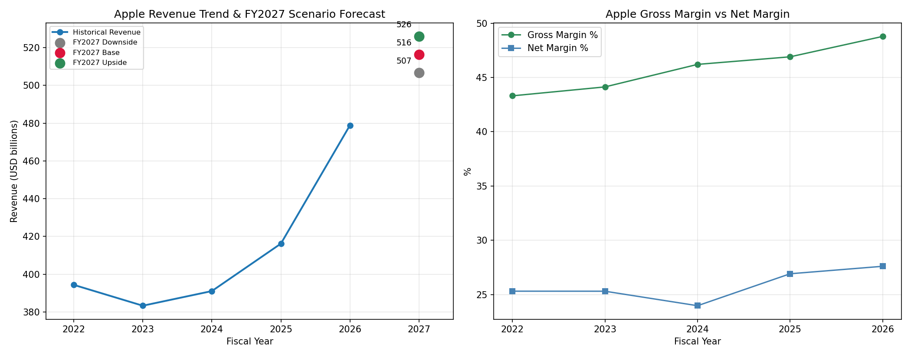

# Apple FP&A Forecasting Model (Python)
A driver-based financial planning & analysis project for Apple Inc., built for FP&A practice.

## Project Overview
This model uses Apple fiscal year income statement data (`FY2022–FY2026`) to calculate historical margins, YoY revenue growth, and build Base / Upside / Downside forecast scenarios for FY2027. It also runs sensitivity analysis to measure how revenue growth shocks impact net income.

## Data Source
Data: https://stockanalysis.com/stocks/aapl/financials/income-statement/

Unit: USD Millions

## Files
- `main.py`: Python source code
- `apple_finance.csv`: Raw historical income statement
- `apple_scenarios.csv`: FY2027 three-scenario forecast output
- `apple_sensitivity.csv`: Growth shock sensitivity table
- `apple_fpa_charts.png`: Visualization of revenue trend & gross margin


## How to Run
```bash
pip install pandas numpy matplotlib
python main.py
```

## Key Calculations
The Python script automatically computes:

- Historical gross and net profit margins
- Annual revenue growth rate year over year
- Forecast assumptions using the latest 3 years of financial data
- Three forecast scenarios for FY2027 (Base, Upside, Downside)
- Sensitivity analysis to test how changes in revenue growth affect net income

## Notes
This is a simplified FP&A forecast model. Real corporate FP&A would split revenue by product segments (iPhone, Services, Mac etc.) and use more granular assumptions.
